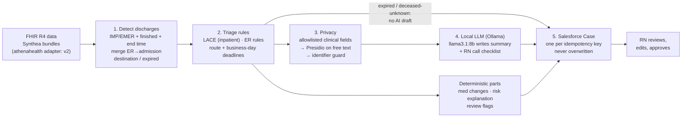

# Discharge Follow-Up Automation

When a patient leaves the hospital or ER, this pipeline puts a ready-to-work follow-up
**Case in Salesforce** for an RN care manager. The Case includes a risk tier the RN can
audit, deadlines that respect business days and holidays, and an **AI-drafted call plan
the RN must approve**. The AI never contacts patients. All data is synthetic.

> **The problem in 30 seconds**
> - **The gap:** after a discharge, the primary care practice often hears late or not
>   at all. A medication change goes unexplained, a warning sign goes unnoticed, and the
>   patient is back in the ER within days.
> - **What this does:** detects discharges from FHIR data and scores readmission risk
>   with explicit rules (the LACE index for inpatient stays, simple rules for ER visits).
>   It works out the 2-business-day contact and 7/14-day visit deadlines, has a *local*
>   LLM draft the RN's call notes from de-identified clinical fields only, and creates
>   one Salesforce Case per discharge.
> - **Built for trust:** rules make the decisions, and the AI only writes the stay
>   summary and checklist. The medication list and risk explanation are deterministic.
>   No PHI leaves the machine, and an RN approves everything.

## Try it

- **Live demo:** [subritii.github.io/discharge-followup](https://subritii.github.io/discharge-followup/).
  Pick a synthetic patient and see each step: discharge detection, the LACE breakdown,
  routing, deadlines, the AI draft, and the exact Salesforce Case payload. Nothing to
  install, and no data leaves your browser.
- **Docker, no secrets needed:**
  ```bash
  docker compose run --rm app    # saved drafts + Salesforce dry run; prints each Case payload
  ```
- **Full mode** (live Ollama + Salesforce): fill in `.env` from `.env.example`, then
  `APP_ENV_FILE=.env docker compose run --rm app python run.py`. See [Docker](#docker) below.

---

## The problem

In value-based primary care (ACO REACH, Medicare Advantage, shared-savings contracts),
the practice is financially responsible for what happens to its patients after a
hospital or ER visit. The days right after discharge are where much of that risk sits:

- **Readmissions** often trace back to medication confusion, missed warning signs, or
  no follow-up visit.
- **Transitional care** generally means an interactive contact within **2 business
  days** and a face-to-face visit within **7 or 14 days**, depending on complexity.
  Missing those windows means worse outcomes and lost revenue.
- **Care managers start from scratch.** A discharge notice arrives, and someone has to
  open the chart, work out what changed, decide how urgent it is, and schedule calls,
  for every discharge, every day.

This project automates the chart-reading and triage so the RN starts from a
prioritized, pre-drafted Case. The RN stays the decision-maker.

---

## How it works



1. **Detect discharges** (`detector/`). A discharge is an Encounter with class IMP
   (inpatient) or EMER (emergency), status `finished`, and an end time.
   - An ER visit that leads to an admission (overlapping, or within 6 hours) is merged
     into one episode, keyed on the admission.
   - The destination (home / SNF / other / expired / unknown) comes from a YAML code
     map.
   - Deaths during the stay or within 3 days count as expired. A deceased flag with no
     date goes to an RN to confirm before anyone calls.
2. **Triage** (`agent/triage_rules.py`, rules in `library/`):
   - **Inpatient stays** are scored with LACE (length of stay, acuity, Charlson
     comorbidity, ED visits in the prior 6 months). LACE ≥ 10 is high, 5–9 moderate.
   - **ER-only visits** use simple rules: frequent ED use, comorbidity burden, overdose.
   - **Routing:**
     - home → contact in 2 business days plus a visit in 7 days (high) or 14 days
     - SNF → facility coordination, no patient call
     - expired → informational "close the loop" case
   - Business days are counted in the practice's time zone, with a holiday calendar.
3. **Privacy** (`privacy/`). Only an allowlist of clinical fields can reach the model:
   visit type, destination, length of stay, diagnoses, medication changes, and
   instructions. Free text goes through Presidio, then a guard checks the final prompt
   for this patient's known identifiers.
4. **Draft** (`agent/drafter.py`). One structured-output call to a **local** model
   (Ollama, `llama3.1:8b`). The model writes only the stay summary and the RN call
   checklist.
   - The medication list comes from a deterministic comparison of orders before and
     after the stay.
   - The risk explanation (e.g. *"Moderate risk. LACE 5 = L1 (1-day stay) + A3
     (admitted through the ER) + C1 (Charlson 1: myocardial infarction) + E0"*) is
     built from the rules, never by the model.
   - Rule-based review flags (e.g. a newly started drug with "as needed" instructions,
     or an ER visit for overdose) go to the RN.
5. **Case** (`salesforce/`). One Case per discharge, keyed by encounter id + discharge
   time.
   - Re-running never creates duplicates and never overwrites an RN's edits.
   - Drafts are cached locally, so re-runs don't repeat the slow LLM call.

---

## Integrations

### Salesforce (verified live)
- **Auth:** OAuth 2.0 client credentials via an **External Client App** (no stored
  user password), using `simple-salesforce`.
- **Schema check:** the 12 Case custom fields (`salesforce/schema.py`) are checked
  against the org's `describe()` before writing: types, lengths, the unique External ID,
  restricted picklist values, and create permission.
- **Idempotent creates:** the code looks up `Idempotency_Key__c` first and creates the
  Case only if none exists. The field is Unique + External ID, so if two runs race,
  Salesforce rejects the duplicate and the code resolves to the existing Case.
- **Audit:** field history tracking is on for `RN_Approved__c`.

### athenahealth (preview sandbox)
- **Auth:** 2-legged OAuth (client credentials) against the preview environment.
- **athenaOne REST: verified live.** `scripts/athena_smoke_test.py --mode rest` lists
  the 33 departments of practice 195900.
- **FHIR R4 mode: built, pending approval.** It finds patients, then prints 3
  Encounters, following the server's CapabilityStatement (Encounter search requires
  `patient`). It waits on approval of `system/Patient.read` and `system/Encounter.read`
  for the app.
- **Quota guard:** at most one token request per run. The token is cached (mode 600)
  and reused until expiry, with no retry on an access denial. Tokens and secrets are
  never printed.

---

## How to run

**Requirements:** Python 3.11, [uv](https://docs.astral.sh/uv/), and
[Ollama](https://ollama.com) with the model pulled. Salesforce and athena credentials
are optional; use `--dry-run` without them.

```bash
uv sync                      # installs deps, incl. the pinned spaCy model for Presidio
ollama pull llama3.1:8b
cp .env.example .env         # then fill in the values
```

**`.env` keys** (names only; see `.env.example`):

| Group | Keys |
|---|---|
| Data | `ADAPTER`, `SYNTHEA_DATA_DIR` |
| athenahealth | `ATHENA_BASE_URL`, `ATHENA_CLIENT_ID`, `ATHENA_CLIENT_SECRET` |
| Local LLM | `OLLAMA_BASE_URL`, `AGENT_MODEL`, `JUDGE_MODEL`, `OLLAMA_TIMEOUT_SECONDS` |
| Salesforce | `SF_CLIENT_ID`, `SF_CLIENT_SECRET`, `SF_DOMAIN` (My Domain), `SF_USERNAME` (optional) |
| Deadlines | `PRACTICE_TIMEZONE`, `HOLIDAYS_FILE` |
| Pipeline | `ER_ADMIT_MERGE_WINDOW_HOURS`, `RETRY_DIR`, `LOG_LEVEL` |

**Run:**

```bash
uv run python run.py                               # all fixtures -> drafts -> Salesforce Cases
uv run python run.py --dry-run                     # no Salesforce; prints each Case payload
uv run python run.py --dry-run --offline --drafts demo/drafts   # demo: no Ollama, no secrets
uv run python run.py --model llama3.2:3b --dry-run # compare another local model
uv run python scripts/create_case.py <patient_id>  # one patient
uv run python scripts/athena_smoke_test.py --mode rest   # athenaOne REST (works today)
uv run python scripts/athena_smoke_test.py               # FHIR mode (needs system scopes)
uv run python scripts/build_demo_site.py      # rebuild docs/index.html (the live demo)

uv run pytest                    # 335 unit tests, no network, stub LLM
uv run pytest -m integration     # 1 test against real Ollama (~5 min)
```

### Docker

```bash
docker compose run --rm app      # demo mode: saved drafts + Salesforce dry run, no secrets

# full mode: live Ollama + Salesforce; .env is read at runtime, never copied into the image
docker compose --profile ollama up -d ollama
docker compose exec ollama ollama pull llama3.1:8b
APP_ENV_FILE=.env docker compose run --rm app python run.py
```

Demo mode reads `demo/demo.env` (model names only) and the committed drafts in
`demo/drafts/`, which are the same synthetic drafts `llama3.1:8b` produced locally.
It uses saved drafts because **Ollama in Docker on a Mac is CPU-only**: Docker can't
use the Apple GPU (Metal), so one `llama3.1:8b` draft can take many minutes. On a Mac,
native Ollama is faster. To use it from the container, add
`DOCKER_OLLAMA_URL=http://host.docker.internal:11434` to the full-mode command.

---

## Results

`run.py` over the five Synthea fixtures. This is a re-run: drafts come from the cache
and the Cases already exist, so it finishes in seconds and creates nothing new.

```
Patient   Discharged  Pathway    Route              Risk               Next action (due)           Draft  Case
--------  ----------  ---------  -----------------  -----------------  --------------------------  -----  -------------------------
982750f4  2025-07-05  er         er_outreach        low                er_outreach 2025-07-09      cache  exists 500bm00003FSscnAAD
91c3a84d  2023-09-01  er         er_outreach        high               er_outreach 2023-09-07      cache  exists 500bm00003FSvnZAAT
91c3a84d  2023-12-17  inpatient  patient_follow_up  high (LACE 11)     patient_contact 2023-12-19  cache  exists 500bm00003FST9mAAH
91c3a84d  2026-04-05  er         er_outreach        high               er_outreach 2026-04-08      cache  exists 500bm00003FSKzKAAX
91c3a84d  2026-05-10  er         er_outreach        high               er_outreach 2026-05-13      cache  exists 500bm00003FSzHhAAL
922fb35e  2026-02-10  inpatient  patient_follow_up  moderate (LACE 7)  patient_contact 2026-02-12  cache  exists 500bm00003FT0X7AAL
ea33f67a  2025-05-22  inpatient  patient_follow_up  moderate (LACE 5)  patient_contact 2025-05-27  cache  exists 500bm00003FRtnsAAD

5 patients, 7 discharges | drafts: 0 generated, 7 from cache | cases: 0 created, 7 already existed | errors: 0
```

The first run generated 6 drafts and created 6 Cases in 19.8 minutes, with no errors.
The 2025-05-22 contact is due on the 27th because Memorial Day falls on the 26th.

**Key numbers**

| | |
|---|---|
| Full Synthea run (49 patients) | **306** qualifying hospital/ER encounters → **287** discharge notices after merging **19** ER→admission pairs |
| Expired-patient rule | Close-the-loop cases fixed from **190 → 3** once "deceased" was limited to deaths during the stay or within 3 days after |
| Tests | **335** unit tests + 1 live-LLM integration test |
| Fixtures | 5 patients trimmed from real Synthea v4.0.0 output (seeded, reproducible), each < 100 KB |

---

## Safety

- **Synthetic data only.** Synthea fixtures and the athenahealth preview sandbox. Never
  real PHI.
- **Data minimization first.** The LLM input is a pydantic allowlist (`extra="forbid"`),
  and a test pins its fields.
  - The function that builds it never receives the patient record.
  - Calendar dates become length of stay.
  - Risk tier and LACE are kept out of the prompt entirely.
- **Presidio as a safety net, not a guarantee.** Free text is redacted with
  `en_core_web_lg` plus custom recognizers (MRN, record ids, street, state + ZIP, phone
  shape). A guard then checks the exact prompt, and the model's output, for this
  patient's known identifiers. **Limits:**
  - It can miss other people's names that NER doesn't recognize.
  - It can miss unusual date formats and nicknames.
  - Bare city names in free text are a known gap (a HIPAA Safe Harbor identifier).
  - Details in [`docs/privacy.md`](docs/privacy.md).
- **Deterministic where it matters.** The med changes, risk explanation, deadlines,
  routing and review flags all come from code and YAML rules. The model writes only
  prose the RN reviews.
- **The RN approves everything.** Every Case is labelled "AI draft — requires RN review
  and approval. Not sent to the patient." Expired patients and deceased-date-unknown
  cases get no AI draft and no patient call. Cases carry FHIR ids only, no names or
  birth dates.
- **Local model.** Ollama on the machine, with no data sent to a paid API.
- **Secrets** live in `.env` (gitignored). Tokens are cached with mode 600 and never
  printed.

---

## Limitations

- **Synthea has no medication stop events.** Orders have no end date, and `status` is
  the status today. Only started / continued / given-in-hospital are detected. Stopped
  meds and dose changes are not ([`library/guides/med_changes.md`](library/guides/med_changes.md)).
- **No drug-interaction checks.** For example, the med_changes patient was switched
  from ticagrelor to prasugrel on top of aspirin. The pipeline lists both but doesn't
  flag the switch.
- **ER rules are minimal and need clinical review.** They cover frequent use,
  comorbidity and overdose. Repeat overdoses, falls in older adults, chest pain and the
  like are not covered.
- **Triage rules are illustrative.** The LACE thresholds, the Charlson SNOMED map and
  the routing are labelled *pending clinical review* in the rule files.
- **The local 8B model is slow:** about 5–7 minutes per draft on an 8 GB Apple Silicon
  machine, because the model swaps. The draft cache and `--model` exist for this reason.
- **Existing Cases are never updated.** Cases created before a rule change (e.g. the
  three overdose ER visits created as low risk) keep their original values. Only new
  runs pick up new rules.
- **Destination is usually unknown on Synthea.** Synthea never sends a discharge
  disposition, so most Cases ask the RN to confirm where the patient went.

---

## Version 2

| Item | What |
|---|---|
| LLM judge | A second local model (`qwen2.5:7b`) checks each draft against its input before the Case is created |
| Drug-interaction checks | Antiplatelet switches, duplicate therapy, anticoagulant + antiplatelet |
| Medication stop events | Hand-made fixtures with stops and dose changes, so changed/stopped meds can be detected |
| PDF intake | Discharge summaries as PDFs (pdfplumber, OCR later) |
| Patient matching | Match notices to patients, with synthetic MRNs independent of record ids |
| athenahealth adapter | Full FHIR R4 adapter with shared contract tests; NUBC discharge codes in the disposition map |
| FastAPI | HTTP endpoint to receive notices |
| Evals | Labelled synthetic discharges: triage accuracy, med-change precision/recall, redaction leak rate |
| Salesforce Flow | Route Cases to community queues, create Tasks, export metadata |
| Broader ER rules | Clinical review of ER-only rules (repeat overdoses, falls, chest pain) |
| Retry folder | Failed notices written to `RETRY_DIR` for reprocessing |

---

## Project layout

```
adapters/     FHIR R4 -> domain models (Synthea; athena in v2)
detector/     discharge detection, ER->admission merge, destination
agent/        LACE / Charlson / ER rules, deadlines, med diff, risk explanation, LLM draft
privacy/      allowlisted payload, Presidio redactor, identifier guard
salesforce/   Case field spec + schema check, idempotent client
library/      rules (YAML), prompts, holidays, guides for clinical reviewers
pipeline.py   one patient end to end      run.py   all fixtures + summary
scripts/      create_case.py, athena_smoke_test.py, make_fixtures.py, build_demo_site.py
docs/         index.html (live demo, generated), plan.md (build log, decisions), privacy.md
tests/        335 unit tests + fixtures (trimmed Synthea v4.0.0)
demo/         saved synthetic drafts + secret-free settings for demo mode
Dockerfile, docker-compose.yml   app + optional Ollama (profile "ollama")
```
